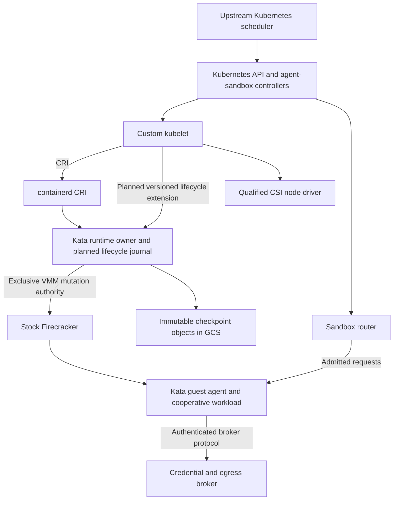

# Custom Kubelet Technical Design

Status: revised design proposal. Implementation, conformance, capacity, and recovery claims require the validation gates in section 16. Scale interpretation and recovery objectives remain open.

Audience: engineers implementing and reviewing the node agent, runtime integration, and sandbox controllers. This document defines their ownership boundaries, lifecycle invariants, and acceptance conditions.

### Implementation status, 2026-11-10

- Selected stack: Brie node agent -> containerd CRI -> Kata -> Firecracker.
  Keep the upstream Kubernetes scheduler. Kata owns VM mutations and guest control.
- Merged in `main` ([#26](https://github.com/ameukam/brie/pull/26) to
  [#28](https://github.com/ameukam/brie/pull/28)): the read-only CRI client and
  the opt-in `--runtime-socket` startup observation of CRI `Version` and
  `Status`. The custom gRPC guest-control prototype was removed before merge.
  Kubernetes client libraries are pinned to v0.37.2. Without
  `--enable-workloads`, `--kubeconfig` registration remains cordoned, tainted,
  NotReady, and zero-capacity regardless of runtime health.
- [#29](https://github.com/ameukam/brie/pull/29), merged on 2026-11-10, adds
  the fail-closed restricted Pod profile validator (section 4.4) and bounded
  read-only CRI sandbox/container inventory (section 6.3). Nothing in `main`
  calls either yet; it enables no execution.
- Draft [#40](https://github.com/ameukam/brie/pull/40) implements explicit
  `--enable-workloads` mode: multiple scheduler-assigned restricted Pods per
  node, CRI image/sandbox/container lifecycle, local admission with RuntimeClass
  overhead, truthful PodStatus, deletion, and journal-based restart
  reconstruction (section 6.3). It is not reviewed or merged; defaults are
  unchanged.
- A disposable C4A smoke run on 2026-10-30 executed two upstream-scheduled Pods
  through Brie -> containerd 2.4.2 -> Kata 4.3.1 -> Firecracker on Arm64 bare
  metal with the Node authorizer and NodeRestriction enabled (section 15.1).
  It fixed a NodeRestriction readiness bug and exposed the terminal-deletion
  cleanup gap in section 6.3. This is smoke evidence, not M1 completion,
  capacity qualification, or Node Conformance.
- The list form of the deletion-evidence rule in section 6.3 is implemented
  on a local `deletion-evidence` branch stacked on draft #40, with fake-runtime
  regression tests. It is unreviewed, unmerged, and not rerun on hardware.
- Next: review and land draft #40 and the deletion-evidence change, then add probes and exec/log streaming within the profile
  and the reproducible M1 harness. Do not bypass Kata ownership or reintroduce a
  custom guest-control service.
- Cooperative VM pause, durable checkpoints, and restore remain unimplemented.
  They require a separate Kata-owned extension, not container freezing.
- Document revision, 2026-11-10: adds node-agent component sections for
  admission management (section 7), hypervisor (8), snapshot (9), image (10),
  network (11), and observability (12), extends reconciliation (6), and
  renumbers the former sections 8 to 13. It changes no code and closes no
  decision. Sections 6.4, 10.2, and 12.2 record limits of the execution
  increment found by code reading, two of them reproduced against the fake
  runtime; they are unscheduled.

### Lab run r20261113, 2026-11-13 (local branches only)

- Scope of evidence: unit, fuzz, and local e2e tests against fake CRI
  runtimes, fake API servers, a fake Firecracker API socket, and a fake GCS
  server. No hardware, cloud project, Kata VM, or Firecracker process was used,
  because the run's authorization named no project, zone, or spend ceiling. No
  item below is hardware-verified, and no gate in section 16 passed.
- Local branch `design-impl-r20261113`, unreviewed and unmerged, builds on the
  deletion-evidence increment. It adds the following, all opt-in and disabled
  by default:
  - the creation-evidence rule, per-Pod fault isolation, and bounded per-Pod
    workers with priority for stop, delete, and status work (section 6.4);
  - journal compaction and watch-based assignment with bookmarks and relist
    (sections 6.2 and 6.4);
  - bounded, deduplicated pull workers with backoff, and CRI image collection
    (section 10.4);
  - a kubelet-style serving endpoint with TokenReview and SubjectAccessReview;
  - probes (exec, httpGet, tcpSocket) and the matching validator increment;
  - metrics, Events, structured logs, and container log rotation (section 12);
  - a cooperative guest supervisor protocol reached through CRI ExecSync, a
    sample counter workload, a checkpoint manifest schema, a GCS store, and a
    conditional checkpoint-reference commit helper (sections 3 and 5);
  - label- and cost-guarded lab scripts, tested only with a mock `gcloud`.
  Independent reviews found safety defects in every lane; the reported fixes
  are applied.
- A local Kata 4.3.1 fork adds a versioned `brie.lifecycle.v1alpha1` ttRPC
  service in the shim. It has a durable operation journal, idempotent operation
  IDs, and stale-generation rejection. Firecracker pause and resume use
  `PATCH /vm`, and full snapshots go to operation-scoped new paths. Restore
  loads into a fresh process but is reported unsupported: container identity
  mapping, agent reconnect, and create-time wiring remain open. Brie does not
  call the extension, and the WarmPaused state is not implemented.
- A local agent-sandbox v1.0.11 fork adds experimental Sandbox fields: desired
  lifecycle, placement epoch, committed checkpoint, and fenced execution. It
  also adds a fence-gated replacement Pod and a bounded router wake path behind
  a flag. No fencing owner or runtime consumes them.

## 1. Requirements and unresolved decisions

### 1.1 Confirmed requirements

- Build a custom, standalone Kubernetes node agent in Go.
- Use containerd's CRI implementation with Kata Containers and Firecracker as the only VMM. Brie replaces kubelet; Kata supplies the runtime owner and guest execution layer.
- Target upstream Node Conformance for the pinned networked node profile. Publish all results and resolve failures before claiming conformance; application-specific hibernation tests provide additional evidence.
- Use stock upstream Firecracker on GCP `c4a-highmem-96-metal` Arm64 bare-metal hosts. The intended machine has 96 cores and 768 GB of documented memory; actual usable memory, NUMA topology, storage limits, and network tier must be measured on the selected image and region.
- Integrate with `sigs.k8s.io/agent-sandbox` and use the upstream Kubernetes scheduler for Pod placement. Existing controllers retain ownership of their resources.
- Support **cooperative hibernation**. Applications explicitly prepare for suspension and restoration. An OCI image alone does not establish eligibility.
- Preserve running VMs across custom-kubelet restarts through runtime ownership and state reconstruction. This is a validation requirement, not an established availability guarantee.
- Use `virtio-blk` for guest block storage. Vsock carries guest control and explicitly supported application protocols. No Firecracker patches or assumption of arbitrary guest filesystem sharing are required.

### 1.2 Decision ledger

This ledger records decisions for the node agent and runtime. Every entry remains open. Owners below are accountable roles, not assigned people; name an owner before starting the affected milestone. On resolution, record the decision, date, supporting evidence, and conditions that would require revisiting it. A candidate value or a successful experiment does not silently close a product decision.

| ID | Decision still required | Accountable role and decision gate | Consequence while unresolved |
| --- | --- | --- | --- |
| D1 | Does one million mean durable sessions, simultaneously existing execution Pods, or both? What are peak active concurrency, wake arrival rates, and acceptable queueing/rejection? | Product and capacity owners; before selecting a production envelope at M4. | Track these populations separately. No host count, cell count, Pod density, or overcommit ratio is approved. |
| D2 | Must a deeply hibernated session retain the same live Pod and Pod UID? | Workload API owner; before adopting the deep-hibernation contract. | M2 tests the baseline that ends the execution Pod after a committed checkpoint and restores into a replacement Pod. Same-Pod deep hibernation requires an additional CRI/status contract before implementation. |
| D3 | Required RPO and RTO for planned evacuation, abrupt host loss, zone loss, and control-plane recovery? | Product and reliability owners; before production replication and recovery-capacity commitments at M4. | Report the last committed checkpoint and measured restore time. Do not promise zero state loss or a recovery deadline. |
| D4 | Required Kubernetes compatibility surface, exact software versions, feature gates, and rollback window? | Node-runtime maintainers; pin the M0 experiment, qualify before enabling the production profile. | Publish a tested support matrix. No blanket node-conformance or runtime-portability claim. |
| D5 | Which self-managed installation and provider mechanism establish and verify VM-execution fencing? | Infrastructure and reliability owners; select installation at M0, prove VM fencing at M2. | Unproven fencing blocks automatic failover qualification. Operator-confirmed fencing has no assumed completion deadline. |
| D6 | Are target hardware/quota, experiment resources, and maintainers available for the custom kubelet, runtime extension, upgrades, and incident response? | Engineering and infrastructure owners; before declaring M0 complete. | Hardware access and sustained maintenance capacity are prerequisites to establish, not consequences of choosing the architecture. |
| D7 | Which checkpoint classes can recovery canaries verify, with what sampling coverage, freshness, resource budget, and tenant-data access policy? | Reliability, workload, and security owners; before the M3 canary qualification. | No continuous-recoverability claim or rollout approval based on unspecified sampling. |
| D8 | What does the node do under host memory, disk, or PID pressure, and do Pod priority and preemption apply on a Brie node? | Node-runtime maintainers and capacity owner; before the staged density increases of G6. | Admission is the only overload control. No eviction, preemption, or pressure condition exists (section 7.2). |
| D9 | How does the node verify the VMM, jailer, guest kernel, and guest image behind a RuntimeClass handler, and which host-side VMM privilege profile is acceptable? | Node-runtime maintainers and security owner; pin at M0, qualify before enabling the production profile. | Handler names are operator claims. No production isolation claim (section 8). |
| D10 | Which registries, credential path, verification policy, and collection thresholds apply to images, and how does a container root filesystem enter a checkpoint? | Node-runtime, storage, and security owners; pull isolation and collection before `--enable-workloads` is recommended beyond disposable labs, root filesystem capture before M2. | Public digest-pinned images only. No image is removed, and one failing pull degrades its node (section 10). |
| D11 | Which CNI, Service proxy mode, and NetworkPolicy enforcement apply to guest traffic, and are dual-stack and host ports in scope? | Infrastructure and security owners; pin at M0, qualify at M1. | One lab CNI configuration. No NetworkPolicy, dual-stack, or host-port claim (section 11.2). |
| D12 | Which serving endpoints, authorization model, metrics, Events, and log retention does the node provide, and what tenant data may logs and metrics carry? | Node-runtime, reliability, and security owners; before the M1 harness exercises probes, exec, and logs. | Node and Pod status and host stderr only. No logs, exec, metrics, or Events through Kubernetes; tests that depend on them cannot pass (section 12). |

RPO is the maximum acceptable loss of acknowledged state. RTO is the maximum acceptable service recovery time. These are product requirements; passing a local snapshot benchmark does not select them.

The original 2,500-5,000 sandboxes per host, 200-400 hosts, and 2-4 cells remain sizing hypotheses. The original sub-25 ms claim activation and sub-40 ms wake TTFB remain experiment targets with explicit start/end points. They are not guarantees for remote restoration, queueing, credential refresh, or storage attachment.

### 1.3 Working assumptions and completion boundaries

- Target Arm64 bare-metal capacity, KVM access, quota, and a supported self-managed installation are obtainable for the prototype. Verify this at M0; no availability or delivery date is established here.
- The engineering organization can maintain the mandatory custom node agent and runtime extension through upstream changes. D6 must establish ownership and resources; these choices do not imply that the capacity already exists.
- Eligible application owners can implement and test cooperative safe points, connection reestablishment, and replay-safe external effects. Unsupported workloads remain outside the hibernation profile.
- The prototype is a decision gate. A failed experiment can change the integration path, scope, or timeline while preserving the confirmed requirements. Failure is not permission to skip a safety invariant.

Approving this document completes a design-delivery milestone only. Prototype completion requires the executable evidence in section 15; production qualification requires the selected profile's section 16 gates and resolution of its open decisions. Each milestone report must identify versions, evidence, unresolved decisions, and the next release blocker. Document approval alone does not provision infrastructure or establish runtime behavior.

## 2. Architecture and ownership

### 2.1 Baseline stack

The integration target is Brie custom kubelet -> containerd CRI v1 -> Kata runtime/shim -> unpatched Firecracker -> Kata guest agent. Firecracker is the only VMM. Brie consumes CRI RuntimeService and ImageService instead of implementing another CRI server or container execution layer.

The maintainer selected option B on 2026-10-26, superseding the 2026-10-23 custom-runtime decision. The C4A experiment verified Kata/containerd container lifecycle, not Pod execution through Brie. The existing Brie owner and Firecracker client remain experimental, not an alternative authority over Kata-owned VMs. The custom gRPC guest-control prototype was removed from #26; local benchmark artifacts are historical evidence only. Exact release combinations must pass gate G1 before adoption.

Containerd supplies image management and CRI services; Kata owns VM lifecycle and guest container execution using its native ttRPC/Protobuf agent protocol. Brie owns Pod admission/reconciliation, probes, truthful status, and node-level integration with those services. Networking, storage, logs, streaming, and resource enforcement still require end-to-end qualification. Native CRI fields are used wherever supported; a versioned lifecycle extension carries only information CRI cannot express.

The tested Kata 4.3.1 Firecracker backend does not implement VM pause/save/resume, and its shim checkpoint method returns NotImplemented. Cooperative VM pause, durable checkpoints, and restore therefore require an owner-mediated Kata extension and validation, not direct Firecracker calls from Brie. These features remain unavailable until implemented. See [runtime benchmarks and C4A evidence](docs/runtime-benchmarks.md).

The router and credential broker are separate processes from the privileged kubelet. Their failure domains, resource budgets, credentials, and restart behavior are independently testable. The kubelet never directly pauses, resizes, snapshots, or terminates a Firecracker process behind the runtime's back.

### 2.2 Responsible components

| Component | Owns | Must not assume |
| --- | --- | --- |
| Existing Sandbox controller, extended where necessary | Desired lifecycle, checkpoint reference, placement epoch, creation/deletion of execution Pods, handoff orchestration | A snapshot URI alone proves durable recovery or source fencing. |
| Upstream Kubernetes scheduler | Binding eligible Pods to nodes using declared resources and tested placement constraints | Suspended Pods release their Kubernetes resource requests. |
| Custom kubelet | Pod reconciliation, admission, probes, status, node authentication, CSI/DRA coordination, host resource policy | It can mutate a VMM concurrently with its runtime. |
| containerd CRI | RuntimeService and ImageService, image/rootfs preparation, shim discovery, CNI coordination, logs and streaming | An accepted request proves guest execution succeeded or a checkpoint is durable. |
| Kata runtime owner/shim and guest agent | VM and container execution, native guest control, local execution state and disks; planned lifecycle extension/journal and pager integration | Stock container pause implements VM hibernation; a local operation remains authoritative after its Pod or generation is superseded. |
| Router | Request authorization, current endpoint lookup, bounded queueing, wake requests | A stale endpoint, Pod UID, or cached Ready state permits execution. |
| Credential broker | Authorized outbound operations and credential use | Guest headers or annotations establish identity or permission. |
| Checkpoint storage | Immutable artifact bytes and committed manifests | Pooled disk capacity provides shared filesystem semantics. |

The CRI service delegates VM/container operations to Kata's per-sandbox owner. Any lifecycle extension must enter that same serialization boundary; the experimental Brie owner must not wrap or compete with it. Owners and VMMs must survive node-agent restart; their process supervision and reconnect protocol require explicit tests. The Kata guest agent reports observed process state and enforces the qualified container isolation profile; cooperative application messages are not a substitute for it.

Use an extension of the existing sandbox reconciliation owner. Do not introduce a second controller that independently creates Pods for the same Sandbox. Any added CRD fields and router/runtime messages require schema, RBAC, version-skew, and migration tests; the names below describe proposed contracts, not existing upstream API fields.

### 2.3 Invariants

1. At most one authorized execution owner exists for a logical Sandbox. Resource-version checks serialize ownership changes; effective source fencing is required before a replacement can execute.
2. All VM mutations, including CRI stop/remove and lifecycle-extension operations, pass through the same per-sandbox serialization boundary.
3. No local deletion or termination needed for hibernation occurs before a recoverable checkpoint is committed. Explicit user deletion follows its separate retention policy.
4. Deletion revokes wake authorization. A delayed request for an old Pod UID or operation generation cannot recreate it.
5. Unknown state is not absence. Unavailable APIs, journals, storage, or runtimes never justify destructive orphan cleanup.
6. Wake and resize reserve capacity before allocating it. Backpressure is a normal outcome when admission cannot safely succeed.
7. PodStatus and CRI observations remain truthful. No terminated VMM is represented as a running container solely to suppress reconciliation.
8. Restore compatibility, identity rebinding, and current authorization are checked before application traffic or side effects are enabled.

### 2.4 Node-agent components

Sections 6 through 12 specify the node agent by component. A component is a responsibility inside Brie or a boundary Brie holds toward containerd and Kata. It is not a separate process and never a second owner of a VM. "Today" describes the unmerged execution increment (draft #40) unless stated otherwise.

| Component | Brie owns | Must not assume | Today |
| --- | --- | --- | --- |
| Reconciliation (section 6) | Converging assigned Pods, the journal, and CRI inventory; the startup barrier; terminal cleanup | Missing or unknown state is absence; an inventory difference authorizes deletion. | Serial two-second poll. No watch. List-based deletion evidence on an unmerged branch; no creation-evidence rule. |
| Admission management (section 7) | Deciding whether a Pod, wake, checkpoint, or resize may consume node resources; durable reservations; explicit refusal | Scheduler binding reserves local capacity; the configured budget is measured capacity. | Profile, overhead, and budget checks for new Pods. No wake, checkpoint, resize, pressure, or preemption admission. |
| Hypervisor (section 8) | The pinned VMM profile it requires and the checks it can make through RuntimeClass and CRI | A handler name proves the VMM, its version, or its privilege; any Firecracker call from Brie is safe. | Handler-name checks only. |
| Snapshot (section 9) | Lifecycle intent, admission, and status for pause, snapshot, and restore requested through the Kata-owned extension | Container pause, a successful return, or a file on disk is a VM snapshot. | Not implemented. The tested Kata backend has no snapshot path. |
| Image (section 10) | Which image references are admissible; presence requests through CRI; image identity in PodStatus | A digest proves availability, authenticity, platform, or guest compatibility. | Unauthenticated pull-if-absent. No collection, credentials, or verification. |
| Network (section 11) | Pod CIDR and DNS configuration passed to CRI; network health gating; Pod IP reporting | A ready CNI proves guest reachability, Service routing, or policy enforcement. | Single-stack Pod networking, observed on one lab CNI configuration. |
| Observability (section 12) | Truthful Node and Pod status; logs, metrics, and operation records | A missing signal means health; a paused guest reports fresh zeros. | Node and Pod status and host stderr. No Events, metrics, serving endpoint, probes, or log rotation. |

## 3. Cooperative workload contract

### 3.1 Eligibility

A hibernation-capable workload implements a versioned prepare/resume protocol through a trusted guest supervisor. Admission checks its supported protocol and template identity. Idle CPU and zero observed ingress streams are hints to request preparation, not permission to freeze.

Preparation must stop accepting new work, reach an application safe point, and account for background tasks, timers, locks, outgoing calls, and child processes. The application declares how external effects are acknowledged and deduplicated. The supervisor can freeze execution, but cannot infer whether an external transaction committed.

If preparation times out or refuses, the sandbox remains active, admission pressure is reported, and policy can retry or use an explicit termination path. The system does not silently snapshot an uncooperative workload and claim resumable application state.

### 3.2 Restore barrier

The cooperative application remains blocked while guest control code runs. Host network and broker gates stay closed independently of guest acknowledgments; guest cooperation is not the security boundary. Before releasing the application barrier:

- Validate Sandbox identity, execution Pod UID, placement epoch, and configuration compatibility.
- Supply fresh entropy using the supported kernel/runtime mechanisms; reinitialize user-space randomness and duplicated application identifiers according to the workload contract.
- Replace expired or revoked credentials and discard cached identities. Refresh projected data before dependent work resumes.
- Reestablish guest-agent RPC and application connections. Firecracker snapshot restoration does not preserve open vsock connections.
- Reconcile wall clock, application deadlines, and external leases. Changing `CLOCK_REALTIME` alone does not repair expired locks or elapsed business deadlines.
- Apply host and guest limits, network policy, broker grants, and storage ownership. Confirm application readiness before publishing an execution endpoint.

Environment variables are fixed process inputs, not a generic post-restore configuration channel. A changed environment, command, security context, or incompatible application configuration requires a fresh process unless the cooperative protocol explicitly supports that change.

### 3.3 Golden templates

Golden templates contain no tenant data, service-account credentials, reusable external sessions, or uncommitted work. An initialized application is eligible only if its post-clone barrier has been validated. Otherwise snapshot before application startup and start the process with its final configuration after restore.

Template compatibility includes image digests, guest kernel, VMM and snapshot format, CPU feature template, device layout, resource envelope, runtime/agent versions, and security profile. An image hash alone is insufficient. Keep template artifacts immutable while any VM or checkpoint references them. Separate template cloning from resuming an individual tenant's checkpoint.

## 4. Lifecycle and Kubernetes semantics

### 4.1 States

These are proposed runtime/session states, not new Kubernetes Pod phases.

| State | VM and resource state | Kubernetes and traffic behavior |
| --- | --- | --- |
| Active | VMM and workload executing within admitted budgets | Execution Pod reports observed container state and readiness. |
| Preparing | Admission of new work closed; cooperative preparation pending | Readiness becomes false; router drains in-flight requests and bounds new requests. Preparation may abort. |
| WarmPaused | Existing VMM paused after acknowledged preparation; memory retained | Pod remains bound and requests remain reserved. Runtime reports an explicit extension state; custom kubelet suspends eligible probes without inventing exits. |
| Checkpointing | Guest paused; memory, VM state, and disks being captured and committed | Pod is not ready. Resize, wake, and deletion are ordered against the current operation. |
| Hibernated | Committed checkpoint exists; source VMM has terminated | Execution Pod completes its intentional shutdown and is removed by its controller. Sandbox identity and checkpoint remain; no live execution endpoint. |
| Restoring | New execution attempt admitted; fresh VMM and disks prepared | Replacement Pod is not ready until restore barrier and probes succeed. |
| Deleting | Wake authorization revoked; stop/cleanup in progress | Terminal intent dominates retries. Retention and deletion acknowledgments govern artifact cleanup. |
| RecoveryRequired | Ownership, artifacts, or compatibility cannot be established | No execution is published. Preserve evidence and report a specific reason. |

WarmPaused is an explicitly negotiated feature of the custom kubelet/runtime pair. A runtime without that capability cannot be paused out of band. Losing extension state while CRI still lists containers leads to reconciliation, not automatic restart or deletion.

Deep hibernation deliberately terminates the execution attempt. The custom kubelet consumes the durable, authorized shutdown intent before applying restart policy. The controller records that intent before requesting runtime termination, removes the execution Pod after acknowledgment, and prevents replacement until wake is requested. Actual container exits remain visible. If termination races Pod deletion, cleanup remains idempotent and cannot schedule a wake.

This baseline incurs API writes and Pod creation on deep wake. If D2 requires keeping a live Pod through VMM termination, design and validate that compatibility contract separately. It must not be implemented by suppressing errors or fabricating Running status.

### 4.2 Runtime extension and concurrency

Standard CRI remains the container/image interface. A versioned lifecycle extension is required for cooperative preparation, pause, checkpoint, and restore orchestration. It enters the same runtime owner as CRI; annotations are not an independent control channel.

Each mutating operation carries Sandbox UID, execution Pod UID, placement epoch, operation ID, and expected runtime generation. The owner journals accepted intent before irreversible work. A retry with the same operation ID returns the recorded outcome; a stale generation is rejected. A lost reply triggers observation of that operation, not a second untracked action.

The owner serializes conflicting operations without holding a global node lock across storage or guest RPC. Work queues have per-node and per-sandbox bounds, cancellation, deadlines, and retry backoff. A wake arriving during preparation either cancels preparation before its commit boundary or waits for the recorded result. Resize waits for a compatible lifecycle state. Deletion prevents new work and waits for or safely cancels the current operation before cleanup.

### 4.3 Same-node resume and deep restore

Warm resume uses `PATCH /vm` to resume the existing paused VM after capacity and authorization checks. It does not reload a snapshot. Warm pause makes no promise of reclaiming dirty guest memory.

Deep restore creates a fresh Firecracker process, loads a verified checkpoint before machine configuration/start, establishes runtime/container identity for the new Pod, and executes the restore barrier. The runtime must map restored containers into the new CRI execution attempt and reconnect guest-agent control. Snapshotting a VM does not by itself implement that mapping; proving it is part of gate G1.

No remote `process_madvise(MADV_DONTNEED)` operation is used. `MADV_PAGEOUT` is not a mechanism for backing anonymous memory with a saved snapshot. Swap is not part of the baseline reclamation design.

### 4.4 Restricted execution profile

The first executable profile restricts each Pod, not the number of Pods or nodes. Brie admits a scheduler-assigned Pod only when it understands the whole specification; any other nonzero field fails closed with a published reason, and fields added by API upgrades must be reviewed before acceptance. The [profile reference](docs/pod-profile.md) lists exact fields. The contract:

- Linux, exactly one ordinary container, `restartPolicy: Never`, and no init, sidecar, or ephemeral containers. Brie never restarts an exited container; a terminal Pod is not a candidate for new execution.
- A digest-pinned image with `IfNotPresent` pull policy and no pull Secrets. Pinning does not establish availability, authenticity, or guest compatibility.
- Equal, positive CPU and memory requests and limits, with no other resources, claims, or Pod-level resources. The Pod names the pinned RuntimeClass and carries the identical API-injected overhead; admission reserves both.
- Pod-level non-root identity with explicit UID and GID, `RuntimeDefault` seccomp, no privilege escalation, and all capabilities dropped. Privileged mode, host namespaces, sysctls, custom LSM profiles, and user namespaces are rejected.
- Literal command, arguments, working directory, and environment values only. No volumes, projected data, service-account token, Secret or ConfigMap references, CSI, or DRA.
- Standard Pod networking and cluster DNS through containerd CRI, CNI, and Kata's guest network path. Ports, host aliases, hostname overrides, probes, lifecycle hooks, readiness gates, TTY/streaming, and resize policies are unsupported.

The upstream scheduler owns placement; node selectors, affinity, tolerations, priority, and topology spread are inputs to it, not reimplemented. The profile check does not replace API validation or Pod Security Admission, and RuntimeClass name equality does not verify the containerd handler, Kata, or Firecracker configuration behind it. Volumes, probes, streaming, and multiple containers are separate reviewable increments that must extend the fail-closed validator and the G1 evidence together.

## 5. Checkpoint durability, ownership, and recovery

### 5.1 Storage and manifest

GCS is the baseline remote artifact store. Hyperdisk provides attached workspace disks and optional local caches. Hyperdisk Storage Pools share provisioned capacity/performance across disks; they are not a shared checkpoint filesystem. Artifact residency and replication must be selected after D3 is resolved. Until then, no zone-loss recovery claim is made.

The first implementation uses self-contained full memory snapshots plus immutable disk generations. Differential snapshots and compression are later optimizations, accepted only with ordered lineage, bounded reconstruction cost, and equivalent crash tests. A compressed byte stream is not directly usable as a Firecracker file memory backend.

A committed manifest identifies:

- Sandbox UID, source execution Pod UID, placement epoch, operation ID, and checkpoint generation.
- VM-state, memory, and every disk artifact by immutable object generation, size, and digest.
- Compatibility tuple from section 3.3, mount/device layout, and application resume-protocol version.
- Application safe-point identifier, relevant external-effect watermark, and creation time.
- Encryption/access policy identity and retention references.

Manifests and artifacts use authenticated storage access and encryption. Hashes detect corruption but do not authorize a checkpoint. Tenant snapshots can contain secrets and user data even when long-lived LLM keys remain in the broker.

Logical volume identities are separate from source host paths. Restore provisions writable target disk generations through the qualified storage integration and maps them into the new execution Pod. It cannot overwrite an attached source disk or assume the source's mount paths identify target volumes. External databases and services remain outside the VM checkpoint and require the application's recovery protocol.

### 5.2 Commit protocol

1. The controller records desired suspension and the expected owner/epoch. The runtime journals an operation and closes admission to new work.
2. The guest acknowledges a cooperative safe point. Flush guest filesystems as required by the storage contract, stop further application writes, pause the VM, and settle host/device I/O using the validated runtime flush sequence. Pausing vCPUs alone is not a disk durability barrier.
3. Capture VM state, full memory, and matching disk generations while mutation remains excluded. Preserve the source and previously committed checkpoint while creating the new generation.
4. Upload immutable artifacts and verify durable object generations and integrity. Publish the complete immutable manifest only after all dependencies are available.
5. The controller conditionally updates the Sandbox's committed-checkpoint reference, checking UID, epoch, and current desired state. A changed/deleted Sandbox cannot adopt a late upload. Unpublished uploads remain unreferenced and are collected only after an operation-aware grace period.
6. After that commit is acknowledged, terminate the source VMM through the runtime and record completion. Remove the old execution Pod. Partial failures retain enough journal and artifact evidence to finish or reconcile this transition.

Failure before commit leaves the previous checkpoint authoritative. The source may resume only after checking that it still owns execution and that no deletion/handoff superseded it. Failure after commit but before termination requires source-state reconciliation; it does not authorize parallel destination execution.

Checkpoint metadata in Kubernetes is a discovery/ownership record, not proof of the durability of bytes. Garbage collection follows references from committed manifests, active runtime operations, and retention policy. It never deletes a base or disk generation still needed by a VM or retained checkpoint.

### 5.3 Placement and fencing

The Sandbox controller uses conditional API updates to serialize placement epochs and execution ownership. Node-local journals record the accepted epoch. Epochs are checked by runtime operations, router lookup, and broker authorization, but an epoch alone does not physically stop an old VM.

Before activating a replacement on another node, require verified source termination or an effective infrastructure fencing action that prevents the old host from executing and writing. If the source is unreachable and fencing cannot be established, recovery remains blocked. Lease expiry or NodeNotReady alone does not prove the source stopped. Attached storage must also be detached/fenced according to its access mode before reuse.

**Leading unqualified recovery risk:** an asymmetric partition cuts a host off from the control plane while its VMs retain outbound access. Checkpoints and destination capacity may be healthy, yet safe recovery cannot proceed until the old execution is fenced. This is a risk hypothesis, not an observed defect. Correct fail-closed behavior can still miss a recovery target; starting a replacement early can duplicate external effects.

For D5, record the exact provider/runtime action, target host incarnation, authorized caller, completion evidence, dependency failure modes, and how fencing remains effective if the old host reconnects or reboots. An accepted API request is not completion evidence. The existing recovery owner coordinates the action; provider controls must remain effective when the source runtime is unreachable. Revoking API access or removing routes does not stop guest writes to external services.

The decisive M2 experiment partitions only the source's control-plane path while a test workload continues writing to a controlled external sink. Keep the successor blocked until fencing is verified, then restore and reconnect the old host. Correlate the fence, execution generations, and sink observations to demonstrate no overlapping authorized execution; test delayed replies, unavailable fencing, and controller restart during the handoff. If fencing fails, retain the safe blocked state, identify the dependency, and report the elapsed interruption and any missed candidate or accepted deadline. This deliberately trades availability for execution safety; select a different qualified fencing mechanism or recovery objective if the trade-off is unacceptable.

On control-plane backup restoration, ownership epochs may roll back. Fence or inventory potentially surviving executions and reconcile independently durable manifests before reauthorizing execution. Do not trust the restored API snapshot as a current inventory.

The platform does not promise exactly-once external effects. Cooperative applications must use idempotency keys, transaction identifiers, or equivalent application semantics when retrying work after recovery.

### 5.4 Failure contracts pending D3

| Failure | Required behavior | Guarantee not yet selected |
| --- | --- | --- |
| Custom-kubelet restart | Runtime retains VMs; reconciliation reconstructs state before mutation/cleanup | Recovery duration at target node density |
| containerd CRI service restart | Kata shims retain VMs; reconnect and reconcile before accepting mutations | No dropped requests or transparent runtime-owner recovery |
| Shim/pager failure | Detect separately, preserve artifacts, prevent unsafe resume, recover only from validated state | Transparent fault-handler takeover |
| Abrupt host loss | Restore only a committed recoverable generation after fencing | Maximum lost work and restore deadline |
| Planned evacuation | Drain, commit, fence source, restore, then publish endpoint | Evacuation deadline and acceptable service interruption |
| Zone/storage loss | Use a verified artifact replica within the chosen failure scope | Replication scope, RPO, and RTO |

Report checkpoint age, commit status, owner/epoch, and the cause of blocked recovery. Periodic checkpoint frequency, replication, standby capacity, and acknowledged-work durability remain production decisions, not inferred defaults.

## 6. Reconciliation and reconstruction

Reconciliation converges three records that can disagree: the API server's assigned Pods and lifecycle intents, the node journal, and the runtime's CRI inventory. It reads all three completely before it mutates anything, acts only through CRI or the lifecycle extension, and treats a disagreement it cannot explain as a reason to stop, not to clean up.

### 6.1 Startup barrier

Before new admission, destructive cleanup, or reporting successful initialization:

1. Authenticate the node and discover CRI inventories, runtime owners, journals, and operation generations. Socket existence is only supporting evidence, not identity or liveness proof.
2. Reconstruct host and guest resource assignments, raw device mappings, disk generations, CSI publish/stage state, and DRA allocations. Host mount tables cannot describe raw block devices or filesystems mounted only inside guests.
3. Load versioned local checkpoints with integrity checks and atomic-write guarantees. Unknown schema or inconsistent ownership enters RecoveryRequired; do not reset allocations and start over.
4. Obtain a complete current view of assigned Pods and authorized lifecycle intents. If the API is unavailable, preserve known execution and retry synchronization; do not classify unseen objects as orphans.
5. Reconcile runtime observations, current Pod UIDs, manifests, and outstanding operations. Only then enable cleanup for individually proven unreferenced resources and admit new work.

Local journal updates use an appropriate durable write/rename/fsync sequence and schema migration policy. Checksums alone do not make multiple state files transactional. Resource accounting and lifecycle operations refer to a common operation generation so interrupted updates can be reconciled.

### 6.2 Watches, status, and runtime events

- Scope Pod watches by assigned node. Use WatchList/bookmarks when supported by the pinned API/client versions, with tested recovery from expired resource versions and full resynchronization.
- Cache authorized Secret, ConfigMap, and ResourceClaim references. Bound cache/watch count and account for unique per-sandbox objects. Retain references until consumers and operations have released them, not merely until a termination observation.
- Keep Lease renewal separate from heavier status work. A proposed starting interval is 10 seconds with jitter; tune within the cluster's node-health thresholds.
- Coalesce noncritical PodStatus updates and avoid no-op writes. Publish terminal states, readiness loss, and deletion acknowledgment promptly. Use supported PATCH encodings and preserve other writers' fields through UID/resource-version checks.
- Do not assume constant NodeStatus size. Bound image reporting if unnecessary; budget volume-related status separately. Per-container state belongs to PodStatus.
- Use CRI container events where supported. Event types include container deletion, not a standalone `SandboxDeleted` event. Perform bounded reconciliation on stream failure and periodic inventory checks against an explicitly chosen detection SLO.
- Bound reconciliation concurrency and prioritize stop/delete, health, and resource-release work over bulk creation. gRPC already multiplexes calls; connection sharding requires evidence of a transport bottleneck.

Node authorization and certificate rotation remain required kubelet responsibilities. A node field selector is not an authorization boundary. Additional CRD access and broker Secret delivery need narrowly scoped controller-managed grants; arbitrary Pod annotations do not grant Secret access. Authenticate and authorize kubelet serving endpoints, including streaming and metrics access.

Under the NodeRestriction admission plugin, a node identity cannot add, update, or remove taints on its own Node after creation. Brie therefore expresses readiness only through Node conditions and allocatable resources: allocatable CPU, memory, and Pods stay zero until runtime health, RuntimeClass verification, and inventory reconstruction pass, and the upstream node lifecycle controller owns the readiness taints. The permanent runtime `NoSchedule` taint applied at Node creation is matched by RuntimeClass scheduling tolerations and is never removed by the agent. The 2026-10-30 run found taint-based gating rejected by NodeRestriction; status-only gating is now a regression test, not an assumption.

### 6.3 Assigned-Pod reconciliation and terminal cleanup

The execution increment implements the startup barrier for the restricted profile. The agent lists Pods assigned to its node with a node field selector and bounded pagination, reads the complete CRI sandbox and container inventory, and reconciles serially on a short poll. Health checks, Lease renewal, and workload RPCs use separate loops and clients, so a slow image pull cannot stall heartbeats. Inventory lists are not an atomic snapshot: a disappeared object or an ambiguous sandbox/container association requires a resync, never deletion.

Each execution has a private, durable journal record keyed by Pod UID. It carries namespace and name, a hash of the admitted execution configuration, the reserved CPU and memory including overhead, and a stage: `reserved`, `sandbox-pending`, `sandbox`, `container-pending`, `created`, `start-pending`, `running`, `finished`. Each pending stage is committed before its CRI call. A lost reply is resolved only by matching runtime observations, including after a restart; an unresolved pending stage blocks replacement and new admission instead of issuing a second create or start. Journal writes use write/fsync/rename/directory-fsync with a schema, checksum, and exclusive lock; a corrupt or foreign journal cannot be replaced to adopt running VMs. Owner labels, the Pod UID in sandbox metadata, and the runtime handler are rechecked before every action; a sandbox whose identity changed is foreign and blocks admission.

Destructive work is authorized by current intent, not by inventory divergence. Before each stop and remove step, the agent confirms the Node identity marker and re-reads the Pod, requiring a deletion timestamp or an observed terminal phase. Graceful stop uses the Pod's remaining deletion grace period. Reservations are released only after `RemovePodSandbox` succeeds and the record is `finished`; the API Pod is then finalized with UID and resource-version preconditions. Shutdown closes connections without stopping VMs.

**Known gap, 2026-10-30:** the API server deletes a Pod in a terminal phase immediately, with no grace period. When a user deleted a Failed Pod right after Brie published its exit status, the Pod object disappeared between two polls. The per-step re-read then failed with Forbidden from the Node authorizer, which grants a node access only to Pods currently bound to it. Brie correctly refused to treat that error as deletion evidence, preserved the exited sandbox and its journal reservation, and blocked admission until an operator removed the sandbox through CRI. The behavior satisfied invariant 5 but has no liveness path.

Deletion-evidence rule, required before `--enable-workloads` is recommended beyond disposable labs. The list form (items 1 to 5) is implemented on an unmerged branch stacked on draft #40, recording the list resource version as `DeletionObserved` and requiring identical resource versions across list pages; `TestExecutionDeletionEvidence` and related tests cover it against the fake runtime only. Watch `DELETED` events are unused until watch-based assignment exists:

1. Evidence of deletion is positive, authenticated, and complete: a successful, complete, most-recent (quorum-consistent) node-scoped list that does not contain the Pod UID, or a watch `DELETED` event for that UID. `spec.nodeName` is immutable once bound, so a Pod absent from such a list no longer exists. A `NotFound` or `Forbidden` response to an exact `GET`, a failed or truncated list, a stale cache read, or any transport error is not evidence.
2. The rule applies only to executions this agent created: the journal record, the sandbox metadata UID, and the owner labels must agree. Foreign and unlabeled sandboxes remain untouched and continue to block admission.
3. Before the first destructive step, the agent journals a `deletion-observed` record with the list resource version or watch event. The stop and remove steps are then authorized by that durable record, remain idempotent across restarts, and no longer require a live Pod read. Without such a record, the current-intent check applies unchanged.
4. A running execution whose Pod was force-deleted follows the same rule with a zero grace period, matching kubelet semantics. This case is a G2 race test, not an assumed-safe path. API unavailability, authorization failures, and partial lists still block cleanup and admission.
5. Control-plane terminated-Pod garbage collection and `kubectl delete --force` produce the same evidence and need no special path.

Until that change is reviewed and merged, operators remove orphaned lab sandboxes through CRI with explicit ID checks; the journal is never edited by hand. The gap is recorded in the execution guide (`docs/pod-profile.md`, extended by draft #40) and is the next release blocker for execution mode.

### 6.4 Loop model and current limits

The execution increment runs three independent loops: Lease renewal every 10 seconds, runtime health and Node status every 5 seconds, and assigned-Pod reconciliation every 2 seconds. Workload RPCs use one CRI client with a two-minute deadline; health RPCs use a second client with a ten-second deadline. Each client admits one call at a time. These intervals are implementation constants, not tuned values or a detection SLO.

A pass handles deleting Pods first, then the rest by creation time, and issues at most one create or start transition per Pod. Any per-Pod error marks the pass incomplete. Until a later pass completes without error, no new Pod is admitted and allocatable resources return to zero at the next status update. Status publication and cleanup for other Pods continue behind that barrier (`TestExecutionRecoveryDoesNotStarveOtherPods`).

The limits below come from code reading on 2026-11-10. The barrier behavior for a spec update and for a failing pull was also reproduced against the fake runtime in a scratch copy of the increment, with the scratch test retained outside Git. No test in the tree and no hardware run covers them.

- One goroutine reconciles every Pod through one serialized client. A slow runtime call delays creation, status, and cleanup for every other Pod on the node, up to the two-minute deadline. Separate loops protect heartbeats, not other Pods.
- Every per-Pod error raises the node-level barrier, and tenant-controlled inputs reach it. A permitted update to a running Pod's spec, such as its image, fails that Pod's reconciliation on every pass, holds the node's allocatable at zero, and admits no other Pod until the updated Pod is deleted. An unpullable image raises the barrier on each attempt (section 10.2).
- A pending stage has no resolution rule. If `RunPodSandbox` fails and leaves no sandbox, the record stays `sandbox-pending`, admission stays blocked, and deleting the Pod does not release it. A failed `CreateContainer` blocks admission until the Pod is deleted. `TestExecutionUncertainAbsence` asserts the fail-closed half. The liveness half is missing, as in the deletion gap of section 6.3.
- The agent does not distinguish a definite runtime rejection from a lost reply. Both leave the stage pending.
- Finished records are retained, and the journal refuses writes beyond 10,000 records or 4 MiB. A state directory therefore has a bounded lifetime execution count until compaction is designed. The Pod-per-wake baseline of section 4.1 makes that bound a design input, not an operational footnote.
- A change is detected no sooner than the next pass, which waits for the poll interval and for any call in flight. No detection latency is measured.

Required before `--enable-workloads` is recommended beyond disposable labs, alongside the deletion-evidence rule:

1. A creation-evidence rule held to the same standard: positive, complete, and bound to this agent's own records. It states which CRI responses and which inventory observations prove that nothing was created.
2. Fault isolation. A fault confined to one Pod's inputs fails or blocks that Pod, with a published reason, and leaves node readiness unchanged. The node-level barrier is reserved for state the agent cannot attribute to one Pod.
3. Journal compaction that never drops a record whose runtime objects can still exist.
4. Bounded per-Pod workers that order stop, delete, and status work ahead of creation, so one slow call cannot hold the node.

Watch-based assignment then replaces the poll (section 15.1).

## 7. Admission management, topology, and scale

### 7.1 Admission decisions

Admission is the node agent's decision that a unit of work may consume node resources. The scheduler places Pods from advertised allocatable resources; it does not see paused memory, restore working sets, snapshot staging, or reconstruction state. Brie decides locally, records the reservation durably before acting, and reports every refusal. A node has one admission path. The router, controllers, and runtime request admission; they do not grant it.

| Decision point | Checks | Refusal | Status |
| --- | --- | --- | --- |
| Node readiness | Runtime and network health, pinned RuntimeClass, one Pod CIDR, complete API and CRI reconstruction, no unresolved execution | Zero allocatable CPU, memory, and Pods; `Ready=False` with a reason (section 6.2) | Execution increment |
| New Pod | Restricted profile, RuntimeClass overhead, representable resources, remaining budget (section 7.2) | Terminal `Failed` phase with a reason; no CRI call | Execution increment |
| Each create or start | Current Pod intent, Node identity, unchanged execution hash, runtime health | Call not issued | Execution increment |
| Warm resume and deep restore | CPU, memory, disk attachment, restore I/O, authorization, compatibility (sections 3.2 and 7.5) | Retryable overload, or `RecoveryRequired` | Not implemented |
| Checkpoint | Memory headroom for a full snapshot, staging space, upload budget (section 9.4) | Sandbox stays active; pressure is reported | Not implemented |
| Resize | Host capacity before growth; cooperative safe point before shrink (section 7.5) | Request stays unfulfilled with a version-appropriate status | Not implemented; the profile rejects resize policies |
| Node pressure and preemption | Undefined | Undefined | Not designed (D8) |

### 7.2 Pod admission pipeline

The execution increment considers a new Pod only while the runtime is healthy, the last reconciliation pass completed, and no execution is unresolved. Checks run in a fixed order and stop at the first failure:

1. Profile. `ValidatePodProfile` checks the Pod against the node name and the pinned RuntimeClass (section 4.4). Failure reports `UnsupportedPod` with the validator's message.
2. Overhead. The Pod's API-injected overhead equals the overhead read from the verified RuntimeClass. Failure reports `RuntimeClassOverheadMismatch`.
3. Resources. CPU is positive, no finer than one millicore, and representable as a CRI quota; memory is a positive whole number of bytes. Failure reports `UnsupportedResources`.
4. Budget. Container limits plus overhead fit the remaining configured CPU and memory, and unfinished executions number fewer than `--max-pods`. Failure reports `InsufficientResources`.
5. Reservation. The agent hashes the execution-relevant Pod spec, commits a `reserved` journal record carrying CPU and memory including overhead, and only then issues a CRI call.

A rejected Pod is published as `Failed` and is not retried, consistent with `restartPolicy: Never`; its controller creates any replacement. Scheduling fields are excluded from the execution hash. Any other change to an admitted Pod's spec fails that Pod's reconciliation and raises the barrier described in section 6.4. The budget counts every unfinished journal record, including pending and unknown executions, and a reservation is released only after `RemovePodSandbox` succeeds (section 6.3). A reconstructed journal that exceeds the configured budget blocks all admission; it evicts nothing.

The scheduler and the journal disagree in one known window. The scheduler stops counting a Pod when it becomes terminal; Brie keeps its reservation until the sandbox is removed. A Pod bound in that window can be refused locally with `InsufficientResources`. The refusal is correct and terminal for that Pod, so its rate is a required signal (section 12.3), not an anomaly to suppress.

The budget is an operator-supplied envelope (section 7.3). Brie does not discover host capacity, measure VMM footprint, or observe host pressure, and the `capacity` it reports equals that envelope, not hardware totals. A fitting budget does not establish that the host can run the Pod.

No node-pressure eviction, priority-based preemption, critical-Pod handling, or QoS ordering exists. Equal requests and limits make every admitted Pod Guaranteed QoS by construction, which narrows the question without answering it (D8).

### 7.3 Count populations separately

Define `N_sessions` as durable logical identities, `N_pods` as execution Pod objects, `N_active` as executing VMs, `N_paused` as memory-retaining VMs, and `N_hibernated` as committed sessions without a VMM. Pending, restoring, terminating, and retained terminal Pods are additional populations in API sizing.

A million sessions does not establish a million active VMs or a million Pods. D1 selects the required operating points and burst envelope. Until then, evaluate both a high-session/low-concurrency case and a high-Pod-count case without calling either the approved deployment.

Admission must budget host reserve, active/paused resident memory, template cache, page tables, VMM/shim overhead, checkpoint buffers, restore working sets, and failure headroom. Measure shared pages and actual cgroup charging rather than summing process RSS. Pod requests remain reserved while Pods remain bound, including WarmPaused Pods.

In the execution increment, the per-Pod VMM and shim reservation is the pinned RuntimeClass `overhead.podFixed`, which the API server injects into each Pod. Brie rejects a Pod whose injected overhead differs from the RuntimeClass it verified and reserves container limits plus overhead against the operator-configured allocatable budget. That budget is an explicit envelope after host reservations, not discovered capacity, and the overhead value must come from measurement on the pinned stack.

Illustrative arithmetic, not workload assumptions:

- 5,000 Pods requesting 512 MiB each reserve about 2,500 GiB before overhead, regardless of observed idle CPU.
- 5,000 VMs each copying 300 MiB of template pages consume about 1,465 GiB before private application state.
- At 500,000 Pods, an 8 GiB etcd backend represents about 16.8 KiB per Pod before history and backend overhead, even if other resource types use separate stores.

### 7.4 Memory backends and reclamation

| Mode | Memory behavior | Admission implication |
| --- | --- | --- |
| File-backed snapshot restore | Clean pages may share the immutable file's page cache; writes become private | Measure private growth, cache residency, NUMA placement, and memcg charging. |
| UFFD restore | Stock path registers anonymous guest memory and copies faulted pages into it | Do not reuse File-backend sharing estimates. Budget copied pages and pager/cache overhead. |
| Warm pause | Existing VM retains its memory mappings and dirty state | No assumed memory release from pausing. |
| Deep hibernation | VMM ends after durable commit | Guest memory can be released; retained local caches still consume capacity. |

Begin with local File-backed restore after fetching a complete verified checkpoint. UFFD is an optimization only after its pager passes crash and correctness gates. This preserves a complete baseline without making remote demand paging a correctness dependency.

Ballooning is best-effort guest cooperation, not hard admission or isolation. Host cgroups enforce limits; a malicious or uncooperative guest can force a VM failure at those limits. Disable `deflate_on_oom` in the initial profile to avoid intentional unbudgeted growth, while still accounting for a compromised driver. Free-page reporting is enabled only on a pinned version that supports and passes tests for it.

A UFFD pager must handle removed ranges and subsequent zero-fill correctly, including balloon interactions, and bound concurrent faults, I/O, and retries. Preserving a file descriptor with systemd FDSTORE does not preserve memory-layout metadata, removed-page state, or pending fault work. Handler failure needs an explicit recovery/fail-stop policy. Do not assume SIGBUS is the only failure mode; a VM may stall on unresolved faults.

### 7.5 CPU, NUMA, resize, and wake admission

Discover topology on the real host. Reserve measured CPU and memory budgets for node services, runtime, storage, and broker traffic. Exclusive CPU allocation follows the supported Kubernetes resource-policy contract; Guaranteed QoS alone does not imply exclusive cores. Shared CPU pools require a tested overcommit envelope. Removing SMT does not eliminate other noisy-neighbor effects.

Wake admission reserves CPU, memory, disk attachment capacity, and restore I/O before accepting activation. Bound concurrent restores and router queues, propagate cancellation/deadlines, and return an explicit retryable overload response when capacity is exhausted. Gang placement requires a coordinated admission decision for the group's execution resources; binding alone does not reserve a successful simultaneous wake.

Resize is serialized with lifecycle transitions. The initial implementation supports only the combinations demonstrated by its Kubernetes/CRI/runtime matrix. CPU quota changes cannot create additional guest vCPUs beyond the VM's configured capacity. An unsupported request remains unfulfilled with a version-appropriate status; it is not reported successful.

For memory growth, admit host capacity before expanding limits and exposing memory to the guest. For shrink, establish a cooperative safe point, verify per-container usage and runtime constraints, reclaim with acknowledgment, and recheck before enforcing lower limits. Guest `AvailableMemory` is an estimate, not proof. If safety cannot be established, defer without first imposing destructive limits. Persist partial progress for crash recovery. Do not promise completion within 100 ms.

### 7.6 Control-plane cells

Choose cell size from measured API, etcd, scheduler, controller, and router limits. Upstream's published cluster scale envelope is a baseline for comparison, not proof that larger cells cannot work. A custom kubelet does not automatically increase those other limits.

The capacity model includes Pods, Sandbox resources, claims, Services, EndpointSlices, PVCs, resource claims, projected data, Events, and watch subscribers. Measure serialized object size, mutation frequency, revision history, compaction/defragmentation, cache memory, and reconnect backlog. Resource-type etcd separation does not partition the Pod population itself.

Do not adopt per-node API QPS independently of the cell budget. For example, 50-100 nodes at 500 QPS permit 25,000-50,000 client requests per second before other controllers. Use bounded clients, retry jitter, server flow control, and phased reconnect/admission. WatchList still transfers and decodes current state.

## 8. Hypervisor

### 8.1 Boundary

Firecracker is the only VMM, stock and unpatched (section 1.1). Kata's runtime starts, configures, and terminates every Firecracker process. Brie reaches a VM only through containerd CRI and, later, through the Kata-owned lifecycle extension (section 4.2). It holds no Firecracker API socket, launches no VMM, and reads no VMM state directly. The Firecracker client and launcher under `internal/runtime` are historical experiments (section 15.2), not a second path.

What Brie verifies today is narrow: the CRI runtime reports the name `containerd`, the RuntimeClass names the configured handler and declares CPU and memory overhead, and each sandbox it acts on reports that handler. None of these observations identifies a VMM. A handler name can map to any shim and hypervisor configuration, so the Firecracker version, jailer use, guest kernel, and device model behind it are operator claims until D9 selects a verification mechanism.

### 8.2 Pinned profile

The hypervisor profile is one tuple in the release manifest (section 14): Firecracker and jailer versions, Kata runtime and guest-agent versions, guest kernel and image, host kernel, machine defaults, CPU template, device layout, and jailer and seccomp settings. Changing any element creates a new profile to qualify and a new snapshot compatibility class (section 9.3).

| Element | Observed value | Standing |
| --- | --- | --- |
| Host | `c4a-highmem-96-metal`, Ubuntu 24.04 Arm64 image, kernel `7.0.0-1014-gcp` | 2026-10-26 runtime-only run. Outside Firecracker's published tested platforms. |
| Firecracker and jailer | 1.17.0 as shipped with Kata; jailer enabled | 2026-10-26 run. Not a qualified version. |
| Kata | Go runtime 4.3.1 | Both hardware runs. No VM pause, snapshot, or restore (section 9.2). |
| Guest | Kata's shipped ext4 image, kernel 6.18.56, configured defaults of 1 vCPU and 512 MiB | 2026-10-26 run. Outside Firecracker's published tested guest kernels. |
| RuntimeClass overhead | 1 CPU and 768 MiB per Pod | 2026-10-30 lab setting. No footprint measurement is recorded for it. |
| CPU template | None | Unselected (D4). |

As of 2026-11-10, Firecracker publishes a tested matrix of AWS bare-metal instances with 5.10, 6.1, and 6.18 host kernels and 5.10 and 6.1 guest kernels. C4A, its host CPU, the lab host kernel, and Kata's guest kernel are outside it. Running there is permitted; qualifying it is this project's burden under D4 and G1, not a property inherited from upstream releases. Firecracker also states that its isolation depends on a correctly configured host. No comparison of its recommended production host configuration with the C4A image is recorded.

### 8.3 Capabilities the design depends on

| Capability | Upstream Firecracker | Tested Kata 4.3.1 backend | Consequence |
| --- | --- | --- | --- |
| Pause and resume a VM | `PATCH /vm` after boot; vCPUs and device emulation stop while the API stays served | `PauseVM` and `ResumeVM` return success without a VMM call | Warm pause needs the Kata extension (section 9). |
| Create a snapshot | Paused VM only; produces a state file and a memory file | `SaveVM` returns success without a VMM call; the shim's `Checkpoint` returns NotImplemented | Same. |
| Load a snapshot | Only in a fresh process, before other configuration | No load path | Deep restore creates a new VMM (section 4.3). |
| Stop a VM | The stop action is x86_64 only | Sandbox stop and removal passed in both hardware runs | On Arm64 there is no VMM stop action. Termination is guest shutdown or ending the VMM process, both under Kata. |
| Add devices to a running VM | Hot-plug of virtio PCI devices is a developer preview | Unqualified | The device layout is fixed before VM start (section 13). |
| Grow memory or CPU | Memory hot-plug is documented; the published feature list has no vCPU hot-plug | Unqualified | Resize is limited to the demonstrated matrix (section 7.5). |
| Mask CPU features | Custom templates; on Arm64 they need host-kernel support for writable ID registers, and the one static Arm template targets Neoverse V1 | Unselected | D4. A template is not a security boundary against a hostile guest. |
| Share a host filesystem | Not assumed (section 1.1) | Block-backed root filesystem through devmapper | Images and volumes reach the guest as block devices (sections 10 and 13). |

### 8.4 Isolation profile

Firecracker runs with its supported jailer/seccomp profile, least privilege, resource limits, and controlled device/socket access. Its userspace vsock implementation is not based on giving each VM a host `/dev/vhost-vsock` endpoint. Apply guest namespaces, cgroups, and supported LSM/seccomp policies through the qualified runtime. Kernel/VMM vulnerabilities remain in the threat model; hardware isolation is not an absolute claim that guest compromise can never lead to escape.

The 2026-10-30 run observed the stock Kata 4.3.1 Firecracker handler keeping the VMM as host root with broad capabilities, behind mount/jail isolation and host seccomp. Guest-side restrictions (non-root UID/GID, no effective capabilities, `NoNewPrivs`, seccomp, cgroup limits) were verified; host-side VMM least privilege is unqualified and is a G1 and G4 item, not a configuration detail to assume.

Firecracker describes its jailer as applying a cgroup and namespace barrier and then dropping privileges. The 2026-10-30 observation shows that the stock Kata handler does not yield an unprivileged VMM; which setting or code path is responsible is not established. Kata's shipped Firecracker configuration also sets `disable_guest_seccomp=true`. The 2026-10-26 run kept that setting, and the 2026-10-30 run observed seccomp filtering in the guest for one configuration. The qualified profile sets both explicitly and verifies them on the host and in the guest.

### 8.5 Failure reporting

A VMM that exits, hangs, or is killed reaches Brie only as CRI sandbox and container state. Brie publishes that state, does not restart the container under the restricted profile, and never reports a terminated VMM as running (invariant 7). It cannot yet tell a guest exit from a VMM crash, a host OOM kill, or a stalled vCPU, and Kata's documented limitations list OOM notifications as not fully supported. Attribution of VMM-level failures is unqualified and belongs to the G1 and G5 evidence.

## 9. Snapshot

### 9.1 Scope and ownership

A snapshot is the VM-level capture: Firecracker's microVM state file and guest memory file, written while the VM is paused. A checkpoint (section 5) is a committed, recoverable set: one snapshot, the matching disk generations, and a manifest. Section 3 defines when a workload may be captured, section 4.3 how a VM resumes or restores, and section 5 when a checkpoint is durable and who may execute it. This section defines the mechanism between them.

Kata's per-sandbox owner is the only caller of Firecracker's pause and snapshot API (invariant 2). Brie requests lifecycle operations through the versioned extension, admits their resource use, and reports their state. It does not read, write, or move snapshot files. The Sandbox controller owns the committed-checkpoint reference. A snapshot file's existence is not a checkpoint.

### 9.2 Current state

No snapshot path exists. In the tested Kata 4.3.1 Firecracker backend, `PauseVM`, `SaveVM`, and `ResumeVM` return success without issuing VMM operations, and the shim's `Checkpoint` returns NotImplemented (section 2.1). Container pause through the shim freezes one container while the guest keeps running: the 2026-10-26 run observed guest uptime advancing during the pause. A successful return from any of these calls is not evidence of a VM pause or a snapshot.

The lifecycle extension is undefined beyond section 4.2. Its design, its acceptance upstream or the cost of carrying it, and its maintenance are prerequisites to establish under D6, not consequences of the hibernation requirement.

### 9.3 Firecracker snapshot semantics

The properties below are upstream's documented behavior, restated because each one constrains this design. They are not validation on the pinned stack.

| Documented property | Consequence here |
| --- | --- |
| Pause, resume, and snapshot creation require a booted VM. Load is accepted only by a fresh process before other configuration, and a failed load ends that process. | Deep restore is a new VMM, never an in-place reload (section 4.3). A failed restore is a terminated attempt to observe and report. |
| A snapshot is a state file and a memory file. Disks are outside it and belong to the integrator. | The owner captures matching disk generations itself (section 5.2). |
| Pause stops vCPUs and device emulation, but in-flight asynchronous block I/O completes until snapshot creation drains and syncs the backing files. | Pause is not the disk consistency point. Snapshot creation gives local durability only, not an upload or a commit. |
| Creation truncates and overwrites existing files at the given paths. | Every operation writes to new paths, or it destroys the generation that section 5.2 preserves. |
| A full snapshot writes all guest memory and faults all of it in. | Checkpoint admission reserves memory up to the full guest size and staging space of the same order (section 7.1). |
| Diff snapshots are a developer preview and generally load only after merging onto a base. | Full snapshots first (section 5.1). |
| A File-backed load maps the memory file privately. The file must stay present and unmodified for the life of the restored VM. | A loaded memory file is referenced state, not cache. Collection follows VM references (section 9.4). |
| The state file names tap devices, block backing paths, and the vsock socket. A load needs each at the same relative path. | Restore recreates those names inside the new VMM's jail and binds them to new logical identities (section 5.1). |
| Open vsock connections are closed and guest listeners survive. Network connection state is not guaranteed. | Guest-agent and application connections are reestablished (section 3.2). |
| The guest wall clock continues from the snapshot instant. The load-time clock option exists only for x86_64 kvm-clock. | On Arm64 the guest corrects its clock before the barrier opens (section 3.2). |
| VMGenID reseeds the guest kernel PRNG on resume, for Linux 5.18 or later with ACPI, or 6.10 or later with DeviceTree. Other duplicated state is not repaired. User-space notification through VMClock needs guest kernel 7.0 or a backport. | The restore barrier still owns identifiers, tokens, and user-space randomness. The tested 6.18.56 guest predates the VMClock notification, absent a backport. |
| Resuming one snapshot more than once is treated as insecure unless a mechanism keeps unique state unique. | One successor per checkpoint. Template clones and canary restores are additional resumes that need their own controls (sections 3.3 and 14.1). |
| A snapshot taken early in guest kernel boot can crash on resume. | Templates are captured after the guest kernel and agent are up. |
| The state format version is independent of the Firecracker version, and nearly every state change raises its major version. | Each Firecracker upgrade is a potential new compatibility class. A reader is retained for every class still promised (section 14). |
| Snapshots resume only on identical hardware and software. Restore across host kernels is unstable; across CPU models it requires invariant guest-visible features; on Arm64 it cannot cross GIC versions. | Host kernel, CPU model, CPU template, and GIC version join the compatibility tuple (section 3.3). Cross-host restore on C4A is unqualified. |
| Firecracker checks only a CRC in the state file and trusts snapshot files and the host. | Authentication, encryption, and integrity of every artifact belong to the checkpoint store (section 5.1). |
| Snapshot disk use scales with guest memory. Integrators must provision for it and enforce quotas where tenants can trigger snapshots. | Staging space is admitted and bounded per node and per tenant (section 9.4). |

### 9.4 Node-side contract

Proposed, not implemented. Operation identity, journaling, and idempotency follow section 4.2; the commit sequence follows section 5.2. This section adds only what the node must hold.

1. Admit before pausing. A checkpoint request reserves memory headroom, staging space, and I/O budget, and a node bounds its concurrent snapshots. A refused request leaves the sandbox active and reports pressure (section 3.1).
2. Write into an operation-scoped staging location that the runtime owner controls. Paths are never reused across operations. Staged files stay unpublished until the manifest commit and are collected only by the operation-aware rule of section 5.2.
3. Keep four populations of local snapshot data distinct: staged output of an active operation, fetched artifacts awaiting restore, memory files mapped by running VMs, and templates. Each has a different owner of its lifetime. None is removed on age or size alone while a VM, an operation, or a retained checkpoint references it.
4. Fetch and verify every artifact completely before load in the File-backed baseline (section 7.4). Recreate the named devices, bind them to the replacement Pod's identities, load, run the restore barrier, then resume.
5. Report the extension state truthfully. A paused or checkpointing sandbox is never reported as running and ready, and never as exited (section 4.1). Probes, exec, log reads, and metric scrapes do not resume it (section 12).
6. Treat every lost reply as an unknown outcome to observe. A snapshot call that returned an error and a call whose reply was lost are both resolved from the owner's journal, not by reissuing the call against the same paths.

Snapshot classes differ in what a resume is allowed to mean:

| Class | Resumes | Control |
| --- | --- | --- |
| Tenant checkpoint | One successor, after the source is terminated or fenced | Sections 5.2 and 5.3 |
| Golden template | Many clones | Credential-free content and a validated post-clone barrier (section 3.3) |
| Canary restore | One disposable VM, in addition to any later production restore | Host-enforced isolation and destruction (section 14.1). The production barrier must not assume it is the first resume. |

### 9.5 Open items

D2 selects whether deep hibernation keeps a Pod. D3 selects recovery objectives. D6 covers the Kata extension's ownership and upkeep. D7 covers canary sampling. D10 covers how a container root filesystem enters a checkpoint. Evidence belongs to G3 (commit and fencing), G4 (clone and resume security), G5 (memory and pager), G8 (format and version skew), and G9 (canaries). No snapshot duration, size, or restore time is a recorded result.

## 10. Image

### 10.1 Ownership

containerd's ImageService pulls, stores, and unpacks images. Its snapshotter prepares each container's root filesystem, and Kata attaches that filesystem to the VM as a block device. Brie decides which image references are admissible, requests presence through CRI, and reports image identity in PodStatus. It never unpacks an image, mounts a snapshot, or passes a host path into a guest.

A Pod names one of the three images that determine what runs:

| Image | Selected by | Today |
| --- | --- | --- |
| Workload image | The Pod's container, digest-pinned (section 4.4) | Pulled through CRI when absent, without credentials |
| Sandbox image | containerd configuration | Outside the Pod and outside Brie's checks. The 2026-10-26 run resolved a digest-pinned `registry.k8s.io/pause`. |
| Guest image and kernel | Kata configuration | Part of the hypervisor profile (section 8.2) |

A digest in the Pod pins the first only. A node whose sandbox or guest image changes runs different code under an unchanged Pod spec, which is why all three belong to the release manifest and to the snapshot compatibility tuple (section 3.3).

### 10.2 Current behavior

For an admitted Pod in the `reserved` stage, the execution increment calls `ImageStatus` for the exact reference and calls `PullImage` only when the runtime reports the image absent. The pull carries the sandbox configuration and no credentials. Pod intent is read before the pull and again after it, so a Pod deleted during a pull never reaches sandbox creation (`TestExecutionDeletionDuringPull`). PodStatus carries the runtime's image reference as `imageID` once a container exists.

The limits below come from code reading on 2026-11-10. A pull that exceeds the client deadline was also reproduced against the fake runtime in a scratch copy. No test in the tree covers a failed or slow pull, and no hardware run exercised one.

- A pull runs inside the serial reconciliation loop under the two-minute workload deadline (section 6.4). Every other Pod on the node waits behind it. A pull that exceeds the deadline is cancelled and reissued from the loop; whether partial progress carries over is unqualified.
- A pull error is handled as a reconciliation error. It raises the admission barrier and zeroes allocatable for one pass, and the pull is reissued on the pass after that, without backoff. Node readiness alternates with each attempt, and no younger Pod is admitted while the pull keeps failing. One unpullable image degrades the node instead of failing only its Pod.
- During a pull and after a failed one, the Pod stays `Pending` with no container status or reason. The cause appears only on the agent's stderr.
- Nothing removes images. Brie calls no `ListImages`, `RemoveImage`, or `ImageFsInfo`. Upstream, collection is a kubelet duty, and no other component in this stack performs it.
- Brie supplies no registry credentials, credential-provider integration, signature or provenance verification, or platform check.

### 10.3 Storage path

Kata's Firecracker integration requires a block device as the VM's backing store and documents containerd's devmapper snapshotter over a thin pool that the operator creates on each node. Consequences:

- The thin pool is node state that must survive reboot. Reinitializing it discards every fetched image and every container root filesystem.
- The pool is shared, so exhaustion is a node-level failure and not a per-Pod one. Exhaustion, metadata sizing, and restart behavior are unqualified. Both hardware runs used a disposable loopback-backed pool with synthetic data.
- Image content reaches the guest as block devices, not as a shared filesystem. Read-only tool and model images follow the same path (section 13).
- An image's unpacked size is charged to the pool and to the snapshotter's base size, not to Pod memory or to the admission budget. Admission does not account for it.
- A running container's root filesystem is a thin device layered on image blocks in one node's pool. Capturing it as a self-contained disk generation, or as an image digest plus a delta, is undecided (D10), and restore on another node depends on that choice.

### 10.4 Proposed baseline

- Admission keeps digest pinning and `IfNotPresent`. Tags and `Always` stay rejected. Pull Secrets stay rejected until a credential path exists (D10). Credentials are not placed in Pod annotations, and Secret access needs a narrowly scoped grant (section 6.2).
- Pulls leave the reconciliation path. Bounded pull workers deduplicate by digest, carry deadlines sized to the image, back off with jitter, and re-read Pod intent before the sandbox is created. A pull failure delays or fails its own Pod, with a published reason, and does not change node readiness.
- Collection is Brie's decision, issued through CRI. An image is never removed while a journal record, a running or paused VM, a template, or a retained checkpoint's compatibility tuple references it. Thresholds come from measured pool usage. A failed or partial image list is not evidence that an image is unused.
- The sandbox image and the guest image are pinned by digest in the release manifest and verified on the node by the mechanism D9 selects.
- Image presence is a restore dependency. A deep restore on another node needs the same image content before load unless the checkpoint carries the root filesystem; registry availability then bounds recovery and belongs to D3.
- Lazy or streaming snapshotters are not assumed. The baseline is one qualified block snapshotter (section 13).

Evidence belongs to G1 (storage path and pool behavior), G2 (deletion, failure, and timeout during pulls), G6 (pull concurrency and disk load), and G8 (collection and retention). Cold and cached startup are measured separately. No pull or unpack time is a recorded result.

## 11. Network and credential broker

### 11.1 Baseline routing

The initial execution profile requires standard Pod networking through containerd CRI, CNI, and Kata's Firecracker guest network path. Brie must supply the correct Pod runtime configuration and qualify network namespace/TAP setup, guest addressing, routing, DNS configuration, and idempotent teardown through that stack. The profile must preserve the Pod IP and Service contracts used by the selected agent-sandbox controller/router. Vsock remains the host/guest control and broker transport, not a replacement for Pod networking. The execution increment passes the assigned Pod CIDR through `UpdateRuntimeConfig` and cluster DNS through the sandbox configuration; the 2026-10-30 run verified Pod, Service, and DNS reachability on one CNI configuration only.

For WarmPaused or Hibernated sessions, the extended Sandbox router holds only a bounded request queue and asks the lifecycle owner for activation. It routes application traffic only after a current endpoint is ready. Authentication, Sandbox UID, placement epoch, deadlines, and retry/idempotency information accompany the request. Ordinary traffic sent directly to a Service is not implicitly a wake request.

Networkless application mode is a separate compatibility profile. It requires controller readiness changes and a router endpoint mapping from Sandbox identity to node and runtime generation, plus a guest AF_VSOCK-to-TCP bridge where applications use TCP. Firecracker's `CONNECT <port>` targets an AF_VSOCK listener, not automatically guest loopback. No annotation is assumed to make an upstream CNI/router implement this profile.

### 11.2 Node network configuration

The execution increment configures Pod networking through CRI inputs and reads two results back.

- Pod CIDR. The control plane assigns one Pod CIDR to the Node. Brie passes it through `UpdateRuntimeConfig` when it changes and stays not ready until a valid one exists. A Node with more than one CIDR is refused, so dual-stack is unsupported.
- DNS. Up to three unicast cluster DNS addresses and the cluster domain come from flags. Each sandbox receives the namespace, `svc`, and cluster search domains with `ndots:5`. The profile requires `dnsPolicy: ClusterFirst`.
- Namespaces and hostname. Network and IPC namespaces are Pod-scoped, the PID namespace is container-scoped, and the hostname is the Pod name truncated to 63 characters.
- Health. Node readiness requires the CRI `RuntimeReady` and `NetworkReady` conditions.
- Address. PodStatus publishes the sandbox's primary IP when it is a global unicast address; a sandbox without one is not ready. The Node's InternalIP comes from `--node-ip`, not from discovery.

`NetworkReady` reports that containerd has a usable CNI configuration. It does not establish that a TAP device reached the guest, that the guest holds the reported address, or that Services, DNS, or NetworkPolicy work for guest traffic. The 2026-10-30 run observed cross-host Pod HTTP, ClusterIP HTTP, and in-guest DNS on one CNI configuration. No result is recorded for NetworkPolicy, MTU, or teardown under failure; host ports and dual-stack are outside the profile.

CNI selection, Service proxy mode, and policy enforcement for guest traffic are open (D11). Host networking is rejected by the profile and unsupported by Kata. Teardown is delegated to `StopPodSandbox`; when it fails, the sandbox and its reservation remain (section 6.3) and no address is released silently.

Snapshots and networking interact. A Firecracker state file names its tap devices, and upstream does not guarantee guest connectivity across a restore. A deep restore into a replacement Pod obtains its address through ordinary CNI setup, and the guest's interface configuration is corrected before the barrier opens (section 3.2). Restoring with the source's Pod IP is not assumed.

### 11.3 Credential broker

Use a structured request protocol over authenticated host/guest channels. The broker validates sandbox identity, current execution epoch, allowed upstream service/operation, and resource budgets, then originates the outbound TLS request and adds credentials. It does not claim to add headers inside a generic encrypted HTTPS CONNECT tunnel.

The broker uses controller-issued, narrowly scoped credential grants. It validates resolved destinations, ports, TLS names, redirects, and metadata/internal-address restrictions. Redirects cannot silently carry credentials to a different authority. Network policy prevents direct credentialed egress bypass for this profile. Optional inter-sandbox IPC needs an authorized membership policy; a matching annotation alone is not an ACL.

Keeping API keys outside guest memory reduces exposure. It does not prevent misuse of permitted operations, downstream reflection of secrets, or leakage of tenant data already present in a snapshot. Protect broker logs, request bodies, crash dumps, and snapshot access accordingly.

## 12. Observability

### 12.1 Principles and ownership

Observability reports what was observed, when, and by which component. An observation that was not made is reported as unknown or stale, never as zero, healthy, or absent (invariants 5 and 7). Observing does not change lifecycle state: no probe, scrape, exec, or log read resumes a paused guest.

| Signal | Source of truth | Brie's role |
| --- | --- | --- |
| Pod and container state | CRI status of objects this agent created | Publishes PodStatus; never infers state from absence |
| Node health | CRI `Status`, the pinned RuntimeClass, the journal, reconstruction | Publishes Node conditions and allocatable resources |
| Container logs | CRI log files written by containerd | Chooses the directory today; serving and rotation are unimplemented |
| Resource usage | Host cgroups, CRI stats, guest agent | Unimplemented; host and guest usage are exported separately |
| Lifecycle operations | Node journal and runtime-owner records | Correlates by Pod UID and operation ID |
| VMM logs and metrics | Firecracker, configured by Kata | Not collected by Brie |

### 12.2 Current state

The execution increment exposes two API surfaces and one local stream.

- Node status: a `Ready` condition with reason `ExecutionReady`, `ExecutionNotReady`, or `RecoveryRequired`; capacity and allocatable equal to the configured envelope, or zero allocatable; InternalIP and hostname; operating system and architecture. Agent and runtime versions, images, and a serving endpoint are not reported.
- Pod status: phase, host and Pod IP, and one container status with runtime container ID, image ID, start and finish times, exit code, reason, and message, plus the `Initialized`, `PodReadyToStartContainers`, `ContainersReady`, and `Ready` conditions. Rejections carry the reasons of section 7.2. `CONTAINER_UNKNOWN` is published as phase `Unknown`, never as an exit.
- Agent log: unstructured lines on stderr, one per failed loop step, without timestamps, levels, operation identifiers, or rate limiting.

`Ready` currently means that the sandbox is ready with a routable address, the container is running, and the runtime is healthy. No probe runs, so it is not evidence that the application serves.

Absent: Kubernetes Events; metrics and health endpoints; the node serving API for logs, exec, attach, port-forward, and resource metrics; container log rotation and log-directory cleanup; CRI stats and container events; tracing; audit records. The consequences are direct. `kubectl logs` and `kubectl exec` do not work for Pods on a Brie node. metrics-server, HPA, and VPA have no source. Container logs under `--pod-log-dir` are neither rotated nor removed by Brie. An operator diagnoses a `Pending` Pod from host stderr. Conformance tests that execute commands or read logs through the node cannot pass.

### 12.3 Required signals

Proposed. D12 selects endpoints, authorization, and retention; nothing below is implemented.

- Status stays the primary contract (section 6.2). Every blocked or refused transition carries a specific, stable reason on the object a user reads, including image pull failure, unresolved execution, and the admission barrier.
- Events record admission refusals, pull failures, barrier entry and exit, and cleanup blocked on missing evidence. They are deduplicated and bounded, and they supplement status without replacing it.
- The serving endpoint offers logs, exec, attach, and port-forward through CRI streaming, and resource metrics. Every request is authenticated and authorized (section 6.2). A request against a paused or checkpointing sandbox fails with an explicit state; it neither blocks indefinitely nor resumes the VM.
- Agent metrics cover admission decisions by reason, reservations against the budget, age of the last complete reconciliation pass, barrier state and cause, age of pending stages, CRI latency and errors by method, pull duration and failures, journal records and bytes against their bounds, and Lease renewal failures. Lifecycle metrics add preparation timeouts, snapshot bytes and duration, restore phases, and queue age. Section 14 lists the fleet conditions to monitor.
- Agent logs are structured and carry Pod UID, operation ID, and journal stage. They exclude environment values, credentials, request bodies, and snapshot contents, and repeated errors are rate-limited.
- Container logs are rotated and removed under a stated retention policy. Tenant output is tenant data: access follows the same authorization as exec.

### 12.4 Probes and guest metrics

Run ordinary network probes against their configured network target in the networked profile. Use CRI for execution probes and streaming operations. Explicitly reject unsupported probe types in a networkless profile; a vsock probe is not equivalent evidence of Pod network reachability.

Suppress eligible periodic probes only while a recorded cooperative suspension state is valid. Report readiness false and preserve failure/restart evidence. Resume or deep restore refreshes projected data and validates readiness before releasing traffic. Probe suppression is not a mechanism for hiding failed VMs.

Metric collection must not accidentally wake paused guests. Report cached guest samples with their timestamps and an explicit unavailable/stale state; do not invent fresh zero utilization. Export host memory/CPU/I/O separately from guest container usage. Validate metrics-server/HPA/VPA compatibility before claiming accurate autoscaling behavior. Bound metric cardinality; use correlated logs for individual operation histories.

### 12.5 Open items

D12 owns the surface. The serving endpoint and probes are prerequisites of the M1 harness and of any G1 conformance attempt. Authorization of streaming and metrics belongs to G4, capacity metrics to G6, and the operator's ability to identify a blocked transition to G8. No metric, latency, or log volume in this section is a recorded result.

## 13. Storage

| Storage type | Baseline contract |
| --- | --- |
| Container rootfs | One qualified block snapshotter and guest filesystem combination. Plan the device layout before VM start; do not assume arbitrary device hotplug after RunPodSandbox. |
| CSI raw block | Support only drivers/access modes proven to publish the device safely into the runtime. Preserve stage/publish ownership across restarts and handoffs. |
| CSI filesystem | Require an explicit driver/runtime direct-volume contract for guest mounting. Otherwise reject the combination; do not skip required CSI operations. |
| RWX filesystem | Not transparently replaced by immutable images or object/RPC storage. Support needs a separately qualified filesystem solution. |
| Immutable tools/models | Read-only images with tenant access control and a measured cache budget. These are not writable shared volumes. |
| Projected data | Qualified guest delivery with atomic updates and tested token rotation, permissions, and subPath behavior. Refresh after suspension before dependent work resumes. |
| Scratch/emptyDir | Guest tmpfs or a qualified block-backed filesystem, with guest and host accounting, size enforcement, and lifecycle cleanup tests. |

Disk and VM checkpoint generations must agree. Restoring old memory against a newer mutable disk is prohibited unless an explicitly tested application recovery protocol supports it. Reattaching a raw multi-writer disk does not by itself make a filesystem safe for concurrent mounts.

The VMM and guest isolation profile is in section 8.4.

## 14. Maintenance, upgrades, and operations

The maintenance controller consumes the documented GCE scheduled-maintenance notifications and imminent events. Planned notice is an opportunity to evacuate, not a guarantee for emergency maintenance or hardware failure. Explicitly cordon/stop admission and coordinate controller-owned draining; a custom Node condition alone does not make upstream controllers drain workloads.

Evacuation follows the checkpoint/handoff protocol with bounded concurrency, destination admission, and storage bandwidth reservations. Preserve appropriate disruption policy and report blocked workloads. If the deadline arrives before completion, apply the chosen D3 failure policy rather than claiming all state was preserved.

Pin Kubernetes/CRI, Brie, containerd, Kata runtime/guest agent and any lifecycle extension, Firecracker, host/guest kernels, guest rootfs, CPU template, CNI, CSI, and snapshot schema in a tested release manifest. A range such as Firecracker v1.9+ is insufficient; for example, its historical APIs do not all expose the same balloon capabilities.

Upgrade the custom kubelet independently from runtime owners where the extension version permits it. Test rolling skew, journal migration, restore compatibility, and rollback against retained checkpoints. Keep required readers/artifacts available until checkpoints have been migrated or expired under policy. Unsupported snapshots enter RecoveryRequired, not an implicit cold start that discards state.

Operational records include Sandbox/Pod UID, owner epoch, operation ID, runtime generation, manifest generation, lifecycle state, and failure reason. Monitor admission rejections, queue age, preparation timeouts, last committed checkpoint age, upload/restore failure, unresolved faults, PSI/OOM events, stale metrics, control-plane backlog, and reconciliation divergence. Define runbooks for stuck transitions, corrupted artifacts, failed fencing, and checkpoint retention; include recovery from backup before release.

### 14.1 Continuous recovery canaries

After the full checkpoint/restore path is qualified, the existing recovery controller periodically schedules bounded, disposable validation attempts using that same runtime restore path. The purpose is to detect unreadable or incompatible committed checkpoints before an incident, including regressions introduced by candidate runtime upgrades. This adds verification work, not another owner of production execution.

1. Select authorized, committed manifests through the checkpoint catalog and hold references through the existing retention protocol. Recheck authorization and deletion intent before starting; revocation or deletion cancels affected queued/running attempts and triggers cleanup under the tenant's retention policy. A canary cannot extend retention indefinitely. Cover declared runtime/application compatibility classes, snapshot ages and sizes, and storage locations; include cold-cache restores. D7 sets a bounded sampling schedule, attempt lifetime, and maximum evidence age. Report untested classes explicitly.
2. Use a distinct validation identity with narrowly scoped checkpoint-read authorization. Do not transfer the source Sandbox's execution epoch, replace its checkpoint reference, create a production endpoint, or fence its running owner. Restore only into independent disposable writable disks; never attach a production volume for writing.
3. Establish host-enforced isolation before any restored guest code can run. Deny all guest network egress, including metadata and broker access; permit only the trusted control/verifier channel. Issue no production credentials or broker grants. Cached credentials in snapshot memory are still secrets. Keep normal application work behind its barrier and run only a qualified inspection routine against the restored state. Authorization and isolation must not depend on the guest's cooperation.
4. Verify artifact integrity, memory/disk generation agreement, container identity mapping, and the application's declared consistency marker. Exercise restore-barrier checks without releasing ordinary work. A workload that needs unavailable live dependencies for validation is reported as unverified, not passed. Use the candidate and retained rollback runtime tuples before rollout; retain a compatible reader for every checkpoint class still promised by policy.
5. Record manifest identity, consistency point, exact runtime tuple, checks performed, phase durations, and result. Distinguish restore/check failures, verifier failures, and missing or stale coverage. A canary success never refreshes the checkpoint's consistency point or RPO. Logs contain metadata, not checkpoint payloads or credentials.
6. Destroy validation VMs and writable copies before releasing their retention references. Recovery of an interrupted canary follows the same journal rules as other runtime operations. Bound concurrency, bytes, CPU, and I/O, and defer canaries when real recovery needs those resources. Never use reserved failure-recovery capacity to justify normal canary admission.

Failed, missing, unverified, or stale required evidence blocks promotion of the affected runtime/profile and retirement of its last compatible reader; it alerts the responsible owner without deleting the checkpoint or restarting the production workload. Gate G9 uses synthetic checkpoints to verify the canary's own isolation and failure handling before it may inspect tenant checkpoints.

The costs are additional restore capacity, storage reads, application-specific verifiers, and sensitive-data handling. Sampling proves only the tested cases. An isolated restore does not prove source fencing, external-effect deduplication, production routing, full-cohort recovery time, or zone-loss recovery; those remain separate gates. Canary duration is a restore measurement, not service RTO.

## 15. Integration sequence

Start with M0-M1: a one-node prototype using the upstream Kubernetes scheduler. M2-M4 are follow-on milestones, not prerequisites for the first prototype. Initial experiments can proceed while D1 and D3 are open, provided their workload envelope and proposed targets are recorded as experimental.

| Milestone | Runnable outcome and acceptance evidence | Boundary |
| --- | --- | --- |
| M0: establish feasibility | Select one kOps/kubeadm installation and pin Kubernetes/feature gates, host image, containerd, Kata runtime/guest agent, Firecracker, kernels, networking, and storage. Define the owner-mediated lifecycle extension. Verify actual target-host access, KVM, quota, and responsible maintainers; identify the D5 fencing mechanism. | A proposed version list or capacity request is not an available environment. Failed compatibility work revisits the integration path. |
| M1: one-node runtime | Provide a reproducible harness for networked Pod startup, probes, exec, volume/container identity, cleanup, custom-kubelet restart with surviving VMs, and cooperative warm pause/resume with unchanged Pod reservations. Exercise deletion/retry races and record startup/resume latency and host memory footprint. | This is the first executable deliverable. It establishes neither complete Node Conformance nor cross-node recovery. The 2026-10-30 smoke run covered startup, restart survival, and ordinary deletion by hand; M1 requires the reproducible harness and the remaining items. |
| M2: durable recovery | Use two workload hosts and independent control/fencing access. Commit full memory/disk checkpoints, end the source attempt, and restore a replacement Pod. Kill processes at each commit/handoff boundary, exercise the asymmetric-partition scenario in section 5.3, and verify state and external-effect handling. | A valid checkpoint does not authorize a successor. Failed or unproven fencing must keep recovery blocked. |
| M3: lifecycle integration and verification | Integrate the runtime with the existing Sandbox controller and router. Prove resource accounting and recovery after lost lifecycle replies and controller restarts. Qualify isolated recovery canaries, including denied egress, failed checks, stale coverage, cleanup, and rollout blocking. | Requires the M2 recovery path. Canary results do not establish fleet recovery guarantees. |
| M4: production profile | Resolve the decision ledger. Pass conformance and the enabled profile's validation gates; measure the declared concurrency/wake envelope, complete-cohort recovery, upgrades, rollback, and operational procedures. Publish accepted objectives and their evidence. | Approval applies only to the measured profile and supported failure scope. Document merge, smoke tests, and sampled canaries cannot substitute for this qualification. |

Qualify credential-free template cloning before enabling it. Evaluate UFFD, differential checkpoints, networkless routing, and higher density separately after the baseline works. Enable an optimization only if it preserves the established invariants and demonstrates a measured benefit. CSI/DRA, gang, and autoscaler support require separate compatibility and recovery qualification before being enabled.

### 15.1 Current CRI integration and execution path

`internal/cri` in `main` provides read-only CRI v1 `Version` and `Status`,
serialized calls, 64-KiB message bounds, deadlines, cancellation, and explicit
response validation. `internal/nodeagent/runtime.go` uses it for the optional
`--runtime-socket` startup observation and closes the client afterwards. It
neither verifies the Kata runtime handler nor monitors later runtime failures.

Since #29, the same client also has unfiltered `ListPodSandbox`/`ListContainers`
and exact-ID `PodSandboxStatus`/`ContainerStatus`, and `internal/nodeagent` has
the profile validator; nothing in `main` calls them yet. Inventory retains
foreign and non-running objects and fails without partial results on malformed,
duplicate, mismatched, or oversized responses; a successful empty list is
distinct from every error. Draft #40 adds the image,
runtime-config, sandbox, and container lifecycle calls, each without automatic
retries, and the `--enable-workloads` executor described in sections 4.4 and
6.3. Every VM, container, and network mutation stays with containerd and Kata;
arbitrary Pod annotations are never forwarded as runtime configuration.

The 2026-10-30 C4A smoke run used a disposable `c4a-highmem-96-metal` host in
`us-east4-c` with `/dev/kvm`, containerd 2.4.2, Kata 4.3.1, and its Firecracker
handler, a separate Kubernetes 1.37.0 control plane with the Node authorizer and
NodeRestriction enabled, and no worker kubelet. The execution guide
(`docs/pod-profile.md`) records the tested agent digest and evidence checksums;
credential-free evidence is retained outside Git. The upstream scheduler bound two
restricted Pods submitted without `spec.nodeName`; both ran concurrently through
Firecracker within an 8 CPU, 8 GiB, four-Pod budget. Cross-host Pod HTTP,
ClusterIP Service HTTP, in-guest cluster DNS, guest UID/GID, capability,
seccomp, and cgroup checks, exit-code reporting without restart, running-Pod
deletion, and unchanged VM PIDs, container IDs, and guest boot IDs across an
agent restart (40 of 40 direct HTTP samples) passed. An oversized Pod stayed
unscheduled. Not measured: Service continuity during restart, latency, density,
probes, exec, or volumes; host-side VMM privilege was observed but is unqualified
(section 8.4). The terminal-deletion gap in
section 6.3 was the one incomplete cleanup. Lab storage was a loopback-backed
devmapper thin pool; nothing in the run is a capacity or conformance result.

Next increments, each a separate reviewable PR: review of the deletion-evidence
change and hardware evidence for its G2 races; watch-based assignment with bookmarks replacing the poll; probes
and exec/log streaming within the profile; then the reproducible M1 harness.
Node readiness and nonzero allocatable resources remain gated behind runtime
health, RuntimeClass verification, and inventory reconstruction. The
creation-evidence rule, fault isolation, and journal compaction (section 6.4),
pull isolation and image collection (section 10.4), and the serving-endpoint
decisions (D12) are recorded but unscheduled.

### 15.2 Historical custom-runtime experiments

These experiments predate option B. They are not the implementation roadmap.

The initial increment added a bounded, context-aware Firecracker API client inside the experimental runtime boundary, tested against a fake Unix-socket HTTP server. The node agent must not gain direct Firecracker access.

`internal/runtime/internal/firecracker` implements this transport increment for `GET /` and `PUT /machine-config`, referencing the [Firecracker v1.17.0 API schema](https://github.com/firecracker-microvm/firecracker/blob/v1.17.0/src/firecracker/swagger/firecracker.yaml). This is a schema reference, not a qualified runtime version. The nested Go `internal` boundary prevents the node CLI from importing it. Each client allows one in-flight request, bounds response bodies and headers to 64 KiB, and requires a timeout covering queueing through body reads. It ignores unknown instance metadata fields but rejects incomplete or unknown states. Requests are neither redirected nor retried automatically.

The machine configuration method supports only vCPU count and memory size; PUT resets other machine options to Firecracker defaults. It is not a partial resize API. Socket access does not establish runtime identity or authorization. Request serialization is not a lifecycle journal or ownership fence, and a failed or canceled mutation can still have been applied. The future owner must reconcile uncertain outcomes rather than retry blindly. No callers, VMM supervision, or guest execution are wired yet.

The next transport increment adds `PUT /boot-source`, `PUT /drives/rootfs`, and `PUT /actions` with `InstanceStart`, covered only by fake-socket tests. The minimal boot profile accepts a kernel and command line without initrd, plus one virtio-blk root drive named `rootfs` with explicit read-only/writable mode, Sync IO, and Writeback caching to honor guest flush requests. This is not a checkpoint durability guarantee. Artifact paths must be absolute UTF-8 without NUL bytes; they are interpreted in the VMM's filesystem namespace, not inspected or rewritten by the client. The future owner must prepare, verify, and exclusively assign artifacts. Start acknowledgment does not prove guest readiness, and lost replies must not trigger blind retries. No VM is launched and no kernel/rootfs versions are selected by these methods.

Subsequent increments added the experimental owner and launcher, and disposable C4A boot and synthetic guest-control measurements were performed. These do not establish the selected Kata integration. A successful VM boot alone does not satisfy M1 or any conformance claim.

`examples/gce` retains the earlier opt-in custom-runtime boot experiment with an upstream kubeadm control plane and a separate C4A host. Its synthetic kernel/rootfs and direct-client boot path are historical evidence, not the selected Kata deployment. The later runtime-only Kata/containerd experiment and its exact limitations are recorded in [runtime benchmarks](docs/runtime-benchmarks.md). Neither experiment establishes a scheduler-assigned Pod executing through Brie.

## 16. Validation and release gates

No benchmark target below is a recorded result. Tests must record exact versions, machine/image settings, workload mix, offered load, and failure conditions.

| Gate | Evidence required | Acceptance condition |
| --- | --- | --- |
| G1: stack and API compatibility | CRI lifecycle and the complete upstream Node Conformance suite for the pinned node profile; agent-sandbox/router integration; storage capabilities; host-side VMM privilege profile; VMM identity behind the RuntimeClass handler; image pull and thin-pool behavior; logs, exec, and metrics endpoints; new-Pod restore identity mapping | Conformance failures are resolved before claiming a conformant node. Unsupported optional capabilities are rejected explicitly. Report conformance results separately from application-specific tests and CSI driver tests. |
| G2: lifecycle concurrency | Wake/delete/resize/credential-rotation/GC races; dropped replies; process kills at every journal transition; terminal Pod deleted before cleanup, control-plane terminated-Pod GC, and force deletion of a running Pod; failed, slow, and cancelled image pulls; sandbox or container creation that fails outright; permitted spec updates to a running Pod | At most one execution owner; stale generations cannot revive; no unsafe cleanup; operations converge or report a recoverable blocked state. |
| G3: durable checkpoint and fencing | Partial uploads, missing artifacts, corruption, disk flush failure, host power loss, source partition, failed infrastructure fencing, control-plane backup restore | Only complete committed generations restore. A destination cannot execute while the source may still run. Recorded application state and disk generation agree. |
| G4: cooperative clone/resume security | Cached identity and randomness tests, expired tokens/leases, changed environment/security context, cross-tenant artifact access, broker redirects and unauthorized operations | Application barrier prevents premature work; incompatible restores fail; no unauthorized tenant or credential access. |
| G5: memory and pager correctness | File/UFFD comparison; marker pages through dirtying and balloon cycles; removed-page zero-fill; pager crash/restart; snapshot-source outage | No stale page resurrection or silent corruption. Memory charging and failure modes are measured. Handler failure cannot masquerade as a healthy VM. |
| G6: node capacity and latency | Increase density in stages; vary active/paused/hibernated mix, template count, dirty footprint, simultaneous wakes, concurrent pulls and snapshots, disk load, thin-pool exhaustion, and uncooperative guests | No host-wide resource collapse within the declared envelope; bounded overload behavior. Publish CPU, physical memory, I/O, queueing, fault, and application TTFB percentiles. |
| G7: cell and fleet recovery | Realistic object sizes/controllers/watches; full relist after resource-version expiry; reconnect storm; etcd quota/compaction and restore; host/zone evacuation | Bounded backlog and recoverable state within the selected D1/D3 objectives. Cell size derives from evidence, not node-density arithmetic. |
| G8: upgrades and operations | Mixed-version nodes, extension skew, journal/snapshot migrations, rollback, token/certificate rotation, retention/GC, operator recovery drills | Supported upgrade and rollback paths retain readable committed checkpoints and preserve ownership. Operators can identify and resolve blocked transitions. |
| G9: continuous recovery canaries | Restore current/old/corrupt generations using current, candidate, and rollback tuples; attempt guest egress/metadata/broker access; race GC and tenant deletion; restart the verifier/controller; exhaust its budget; expire coverage | No production ownership, endpoint, volume, or external-effect changes; tenant authorization and retention remain enforced; failed/unverified/stale evidence cannot pass a rollout gate; cleanup converges and real recovery retains priority. |

For latency, distinguish claim request -> usable application, warm wake -> first useful response, local full restore, remote restore, and maintenance recovery. Include authorization, queueing, disk preparation, credential refresh, and readiness. The former 25/40 ms targets apply only to explicitly identified experiments; results must not generalize them across these paths.

Production acceptance requires resolution of the decision ledger and evidence for the enabled profile. A successful local prototype does not establish million-session scale, million-Pod scale, or a disaster-recovery guarantee.

## 17. Public references

These sources establish documented behavior, not validation of this proposed integration. Moving upstream branches must be replaced by tested release references in the implementation's compatibility manifest.

- [Borg architecture and public design lessons](https://research.google/pubs/large-scale-cluster-management-at-google-with-borg/): admission control, explicit overcommitment, isolation, and correlated-failure management.
- [GCE general-purpose machine specifications](https://docs.cloud.google.com/compute/docs/general-purpose-machines) and [bare-metal constraints](https://docs.cloud.google.com/compute/docs/instances/bare-metal-instances).
- [GCE maintenance notification scope](https://docs.cloud.google.com/compute/docs/instances/monitor-plan-host-maintenance-event).
- [Firecracker snapshot lifecycle and compatibility](https://github.com/firecracker-microvm/firecracker/blob/main/docs/snapshotting/snapshot-support.md).
- [Firecracker snapshot versioning](https://github.com/firecracker-microvm/firecracker/blob/main/docs/snapshotting/versioning.md).
- [Firecracker UFFD loading and balloon interaction](https://github.com/firecracker-microvm/firecracker/blob/main/docs/snapshotting/handling-page-faults-on-snapshot-resume.md).
- [Firecracker balloon trust model](https://github.com/firecracker-microvm/firecracker/blob/main/docs/ballooning.md) and [vsock transport](https://github.com/firecracker-microvm/firecracker/blob/main/docs/vsock.md).
- [Firecracker tested platforms and feature list](https://github.com/firecracker-microvm/firecracker/blob/main/README.md) and [CPU templates](https://github.com/firecracker-microvm/firecracker/blob/main/docs/cpu_templates/cpu-templates.md).
- [Kata Containers with Firecracker and devmapper](https://github.com/kata-containers/kata-containers/blob/7b1fa8808f1d53e3ab3402bd206955e824f64d4d/docs/how-to/how-to-use-kata-containers-with-firecracker.md) and [Kata limitations](https://github.com/kata-containers/kata-containers/blob/7b1fa8808f1d53e3ab3402bd206955e824f64d4d/docs/Limitations.md), at the commit reviewed in the runtime benchmarks.
- [Linux process_madvise API](https://www.man7.org/linux/man-pages/man2/process_madvise.2.html).
- [CRI API contracts](https://github.com/kubernetes/cri-api/blob/master/pkg/apis/runtime/v1/api.proto).
- [Kubernetes API semantics](https://kubernetes.io/docs/reference/using-api/api-concepts/), [Node authorization](https://kubernetes.io/docs/reference/access-authn-authz/node/), and [large-cluster considerations](https://kubernetes.io/docs/setup/best-practices/cluster-large/).
- [Agent-sandbox router](https://github.com/kubernetes-sigs/agent-sandbox/blob/main/sandbox-router/README.md) and [Sandbox API](https://github.com/kubernetes-sigs/agent-sandbox/blob/main/api/v1beta1/sandbox_types.go).
- [Hyperdisk Storage Pools](https://docs.cloud.google.com/compute/docs/disks/storage-pools).
